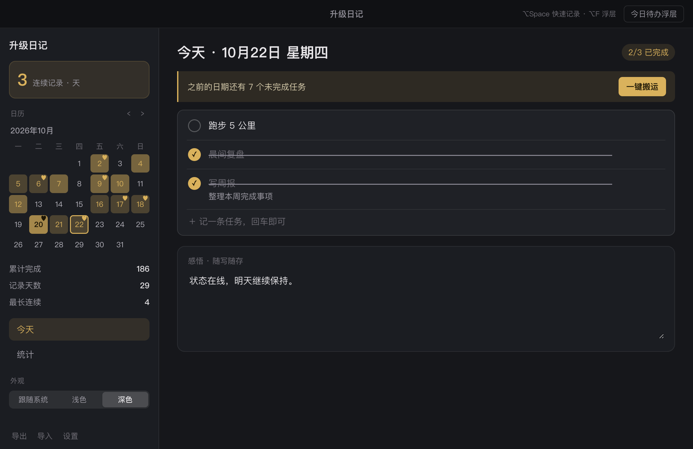
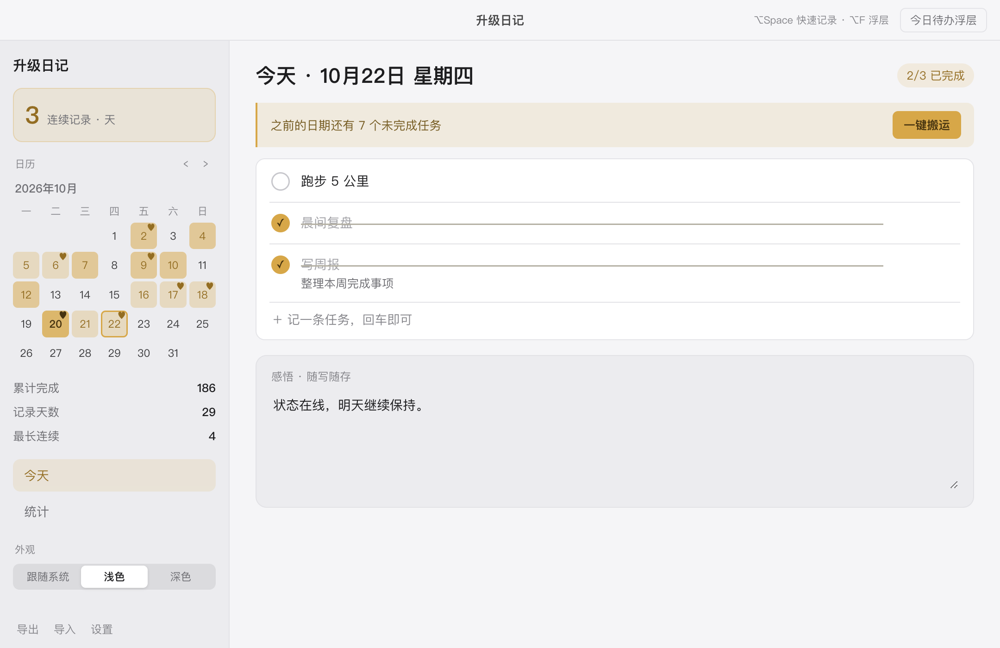
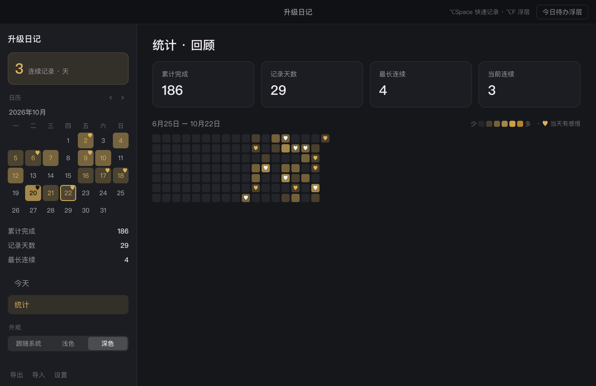

<div align="right">

**简体中文** | [English](README.md)

</div>

# 升级日记

> 每日一页的任务与感悟日记。做完勾掉，写两句话，看着日历一点点变满。

升级日记是一个**本地优先**的 macOS + Windows 桌面应用（Electron），它不试图成为另一个功能全乎的任务管理器，而是专注一件事：**把「今天」记成一页**——任务打勾、随手感悟、翻日历回看，像打怪升级一样攒起自己的记录。

  

## 界面一览

**深色 · 今天**

<p align="center"></p>

**浅色 · 今天**

<p align="center"></p>

**深色 · 统计与热力图**

<p align="center"></p>

> 以上截图使用[示例数据](scripts/seed-sample-data.js)生成，不含任何真实个人信息。

## 特性

- **每日一页任务**：标题必填、描述选填；勾选后划线并沉底，取消勾选回到原位；点击任务文字直接编辑；悬停出现 ⠿ 手柄可拖动排序（完成区/未完成区各自内部换位）
- **一键搬运**：把之前所有日期的未完成任务一次搬到今天，原日期删除（已完成留原日期作历史）；没有欠账时按钮自动隐藏；搬运进来的任务带来源日期标记
- **删除与撤销**：删除无确认弹窗，删除后 toast 提供「撤销」，不打断心流
- **今日感悟**：每页一段纯文本，随写随存（右上角闪现「已自动保存」），历史日期可补记
- **日历回看**：侧栏月历即迷你热力图，与统计页同一套着色规则；点任意日期回看/补记；今天与选中日有标记
- **统计·回顾**：18 周 GitHub 式热力图＋四个数字卡：累计完成、记录天数、最长连续、当前连续
- **今日待办浮层**：全局快捷键（默认 ⌥F）随时唤起置顶小浮层：列出当天未完成任务，可直接勾选、可直接新增；全部勾完出现「今日已清 ✨」并自动关闭；唤起时不打断当前工作
- **快速记录**：全局快捷键（默认 ⌥Space）弹出速记小窗，想到什么回车即存
- **全清时刻**：当天任务首次全部完成，主界面与浮层都会出现「今日已清 ✨」的庆祝反馈
- **主题**：跟随系统（默认）/ 浅色 / 深色，实时切换
- **键盘流**：↑↓ 选中任务、Enter 编辑（编辑态 ↑↓ 自动保存并跳转）、Delete 删除（可撤销）、Esc 逐级退出
- **数据管理**：首次启动引导选择数据文件夹；设置内可更换位置并自动迁移；Markdown / JSON 导出，JSON 导入恢复
- **菜单与退出**：macOS 应用菜单与 Dock 右键均提供「关于/退出」；点窗口 X 即整体退出

快捷键速查（可在设置内录制修改）：
- ⌥Space：全局快速记录
- ⌥F：今日待办浮层开关（唤起/关闭）

## 设计理念

**每日一页。** 日期是主键，任务天生属于某一天。打开应用就是今天这一页；历史不是过滤器里的视图，而是一本一页页翻过去的本子。

**搬运，而不是滚账。** 主流待办工具会把你没完成的事静默自动滚到明天——短期讨好，长期制造一条越滚越长、带来负罪感的清单。升级日记拒绝自动滚账：它明确告诉你还剩几件，搬不搬、删不删由你决定；搬完，旧的一天干净封页。

**克制的打怪升级。** 连续天数、六档热力图、全清时刻的「今日已清 ✨」。没有等级、没有勋章墙——坚持本身被看见，就够了。

**数据是你自己的。** 一份看得见的明文 JSON，无账号、无云端、不联网。每次启动滚动备份，随时导出 Markdown，也可以直接交给 AI 复盘。

## 它刻意不做什么

不做提醒推送。不做优先级/标签/截止日期。不做云同步。不做多设备。不做协作。

> 它是一个安静的个人日记本，不是工作流平台。

对一部分人这是减分项。对目标用户，这是最重要的卖点。

## 开发

```bash
npm install
npm start        # 启动开发窗口
npm run icon     # 重新生成应用图标（build/icon.png）
npm run dist     # 打包 macOS dmg 到 dist/
npm run dist:win # 交叉打包 Windows 安装包到 dist/
```

要求 Node.js ≥ 18。首次启动会引导你选择数据文件夹（默认建议 `~/Documents/升级日记/`）。

工具脚本：

```bash
node scripts/test-store.js                                   # 数据层单元测试
node scripts/seed-sample-data.js <userDataDir> <dataDir>     # 生成截图用示例数据
SJ_SHOT=out.png SJ_VIEW=stats npm start                      # 捕获界面截图（见 src/main/main.js）
```

## 系统要求

- macOS 12 及以上（Apple Silicon）
- Windows 10 / 11（64 位）

## 数据与隐私

应用不联网、不收集任何数据。所有数据以明文形式保存在你选择的文件夹里：`data.json` 与 `backups/`（每次启动滚动保留最近 7 份）。你可以用任何方式备份它、把它放进 git，或交给其他工具处理。

## 反馈

遇到问题或有功能建议，欢迎[提交 Issue](https://github.com/PandaClose/shengji-diary/issues)。项目为个人作品，按需维护，响应可能不快，但每条都会看。

## 许可证

[MIT](./LICENSE)
